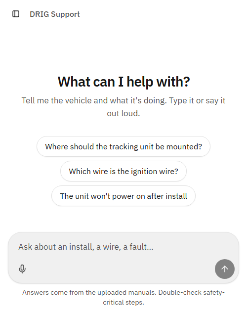
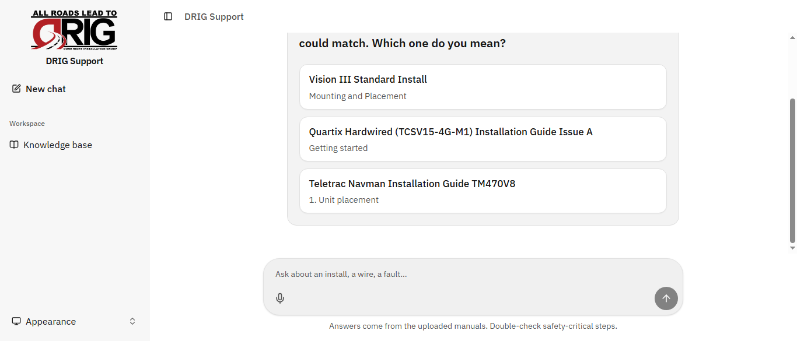
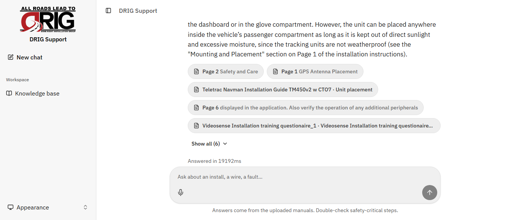
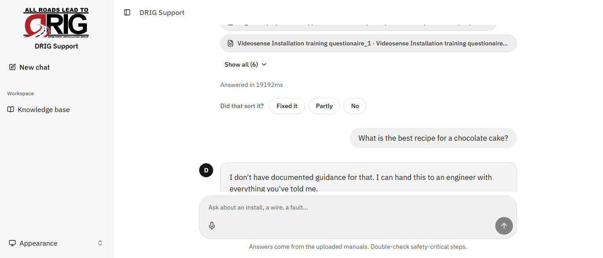
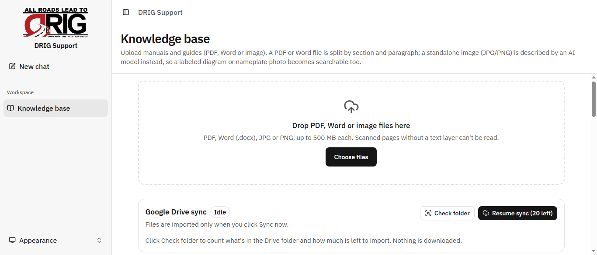
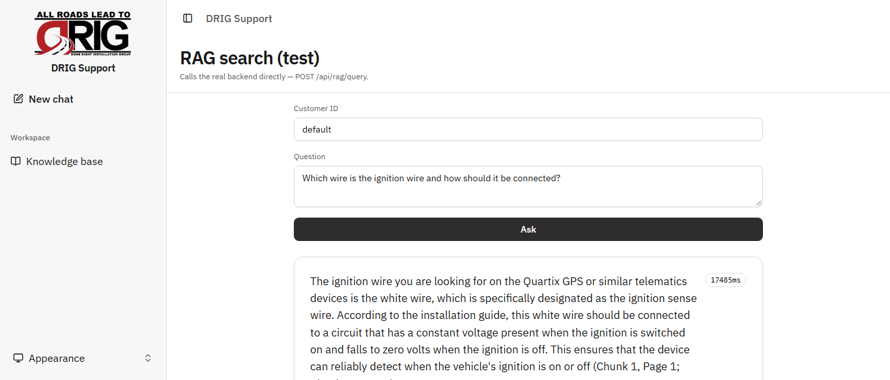
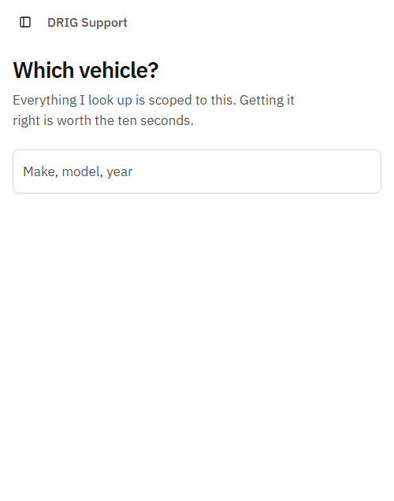
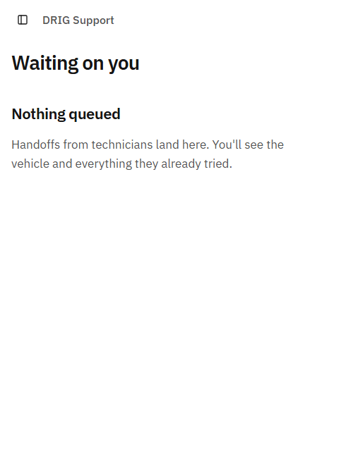
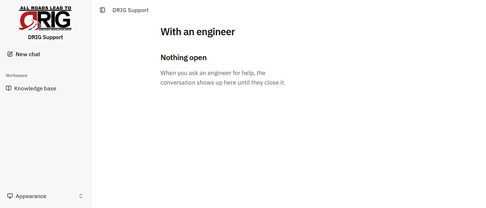
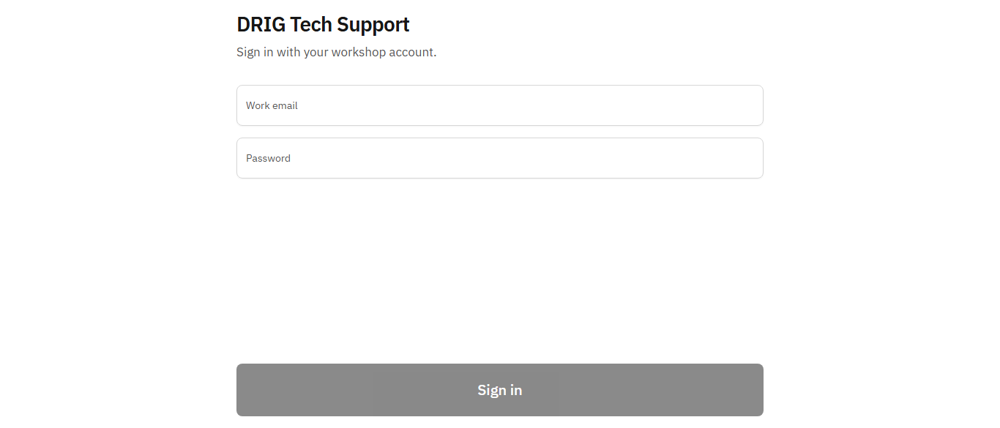

# DRIG Technical Support AI — Client Presentation Pack

**Prepared for:** A prospective-client / business-stakeholder audience (DRIG USA leadership and decision-makers)
**Purpose:** The verified foundation for a professional client-facing video and pitch
**Date:** 22 October 2026
**Accuracy basis:** Written from the actual source code in this repository, not from the proposal document alone. Where the proposal (`Plan/DRIG_System_Blueprint_1.md`) describes something that is designed but **not yet built**, this pack says so plainly in Section A‑11.

> A note on honesty, because it is the product's whole premise: this pack separates **what works today** from **what is planned**. Nothing here claims a feature is finished when the code shows it is a skeleton. The same discipline that makes the assistant trustworthy to a technician is what should make this presentation trustworthy to a client.

---

# DELIVERABLE A — Detailed Project Report

## A‑1. Executive summary

DRIG's field technicians install and troubleshoot vehicle equipment — lightbars, cameras, tracking units, dash cams — at customer sites. When a technician hits a problem, the answer almost always already exists: in a vendor manual, in a wiring guide, or in the memory of an engineer who solved the same thing two years ago. Today, getting to that answer means stopping work, phoning the office, and waiting.

This project puts that knowledge on the technician's phone. They ask a question — by typing or by speaking — and get clear, step‑by‑step guidance in seconds, with a link to the exact page of the exact document the answer came from. If the answer genuinely is not in DRIG's documents, the assistant says so plainly instead of guessing.

The entire system is engineered around a single idea: **trust**. A technician who is given one confidently wrong answer stops using the tool forever. So the product is built to be structurally incapable of two failures at once — inventing an answer, and hiding one that exists. Multiple automated checks run before any answer is shown, and several of them use no AI at all, which is exactly why they are reliable.

Today the assistant answers questions from DRIG's manuals and guides, cites its sources, shows the relevant diagrams, asks for clarification when a question is ambiguous, refuses cleanly when it has nothing to offer, learns from questions technicians mark as resolved, and gives managers a tool to load and manage the knowledge base. Several further capabilities — in‑app vehicle wiring lookup, live engineer handoff, spoken answers, and sign‑in with roles — are designed and partially scaffolded, and are covered honestly in Section A‑11.

## A‑2. Problem statement

The knowledge a technician needs is not missing. It is **fragmented**:

- Spread across hundreds of vendor manuals, each covering a different product.
- Scattered between a master wiring guide, job‑specific schematics, and years of recorded support calls.
- Held partly in the heads of a few experienced engineers.

Because of that fragmentation, a technician with a question has three slow options:

1. **Search the documents** — which requires knowing which of hundreds of manuals covers this product, and finding the right page inside it.
2. **Call an engineer** — which works, but interrupts a senior person, and if the question was already documented, that interruption was avoidable.
3. **Rely on memory** — fast when they have seen it before, inconsistent otherwise.

Every one of these costs time on site, and time on site is the business's most expensive resource. Worse, an inconsistent answer can mean a return visit, a damaged unit, or a safety incident on a live circuit.

## A‑3. Proposed solution

One consistent entry point in front of all of that knowledge.

The technician opens an app on their phone and asks a question in plain language. The system finds the most relevant passages across all of DRIG's documents, decides whether they are actually good enough to answer from, and — only if they are — produces a numbered, source‑cited answer. The relevant diagram is shown alongside. If the match is weak, the system refuses rather than improvise, and records the question so management learns what to document next.

Crucially, the system **reads** DRIG's knowledge; it never rewrites it. Documents stay where DRIG keeps them. The app simply makes them findable and usable in seconds, at the vehicle.

## A‑4. Target audience

| User | What they need |
|---|---|
| **Field technician** (primary) | A fast, trustworthy, hands‑busy answer at the vehicle — by voice or text — with the source so they can confirm before acting. |
| **Engineer** (planned role) | To receive escalations with the full conversation already attached, so nothing is repeated. |
| **Manager** | To load manuals and guides, keep the knowledge base current, and see what technicians keep asking that isn't yet documented. |
| **Administrator** | To manage the system, users, and settings (planned). |

The design is dominated by the technician's real conditions: a noisy workshop, poor signal, gloved or busy hands, and bright or dark light. That is why touch targets are large, primary actions sit in the bottom third of the screen, numbers are shown in an unambiguous typeface, received answers stay readable offline, and voice input uses press‑and‑hold rather than always‑listening.

## A‑5. Core functionalities (what is built today)

For each feature: **what it does · how it's used · the problem it solves · why it matters · what the user sees.**

### A‑5.1 Ask by typing — grounded, cited, streaming answers
- **What:** The technician types a question; the answer appears word‑by‑word, formatted as numbered steps for procedures and plain prose otherwise, with the page or section cited inline.
- **How:** Type in the composer on the main chat screen and send. The answer streams in live, so the technician sees progress immediately rather than staring at a blank screen.
- **Problem solved:** Finding the right paragraph in the right manual, fast.
- **Why it matters:** Every fact is traceable. The technician can tap the citation and see the exact source before acting.
- **User sees:** A numbered procedure or short explanation, each point ending with "(Page 3)" or a section name, with tappable source chips.

### A‑5.2 Ask by voice — press‑and‑hold speech input
- **What:** The technician holds a button, speaks the question, and it is transcribed into the chat and answered through the same pipeline.
- **How:** Press and hold the microphone button on the composer; a waveform confirms it is listening; release to send.
- **Problem solved:** Hands are inside a dashboard; typing isn't practical.
- **Why it matters:** The workshop is noisy, so always‑listening fails — press‑and‑hold is deliberate and reliable. The device negotiates the correct audio format per phone (important for iPhones).
- **User sees:** A live waveform while speaking, then their transcribed question and the streamed answer. *(Reading the answer back aloud is planned — see A‑11.)*

### A‑5.3 Source citations and diagram viewing
- **What:** Every answer carries its sources. Tapping a source that is backed by a diagram opens that drawing full‑screen; tapping a text source opens a reading panel with the exact passage.
- **How:** Tap a citation chip under any answer.
- **Problem solved:** "Where did this come from, and can I trust it?"
- **Why it matters:** The system shows diagrams but does not try to read values off them — because a diagram that breaks convention is exactly where an AI would confidently misread it. Finding the right drawing is the hard part; the technician reads it.
- **User sees:** The exact page image or passage, zoomable, with the document title and page.

### A‑5.4 "I don't have that" — clean refusal instead of a guess
- **What:** When nothing retrieved is relevant enough, the assistant stops before writing anything and says it has no documented guidance, offering to involve an engineer.
- **How:** Automatic; happens before any answer is written.
- **Problem solved:** The single most damaging failure — a confident, wrong answer.
- **Why it matters:** This is the feature that earns long‑term trust. An AI given thin material *will* produce something plausible; removing it from the process removes the risk.
- **User sees:** A neutral, non‑alarming message: "I don't have documented guidance for that. I can hand this to an engineer with everything you've told me."

### A‑5.5 Clarification — one real question, only when it changes the answer
- **What:** When several documents match a question about equally well and the question doesn't say which applies, the assistant asks one specific question instead of guessing.
- **How:** Automatic; the technician taps the option that fits.
- **Problem solved:** Ambiguity that would otherwise produce a correct‑looking answer for the wrong product or variant.
- **Why it matters:** It only asks when the answer genuinely depends on it — not with generic prompts.
- **User sees:** A short multiple‑choice prompt, e.g. "Single or dual colour?"

### A‑5.6 Answer verification with a caution flag
- **What:** After an answer is written, the system runs additional checks: that every citation is real, that specific values (wire colours, pin numbers, fuse ratings, torque, voltage) match the cited source, and that no safety/disconnect/isolation step from the source was dropped.
- **How:** Automatic, before the answer is finalized.
- **Problem solved:** The "right‑looking paragraph with one wrong number," and the silently dropped safety step.
- **Why it matters:** The first checks confirm what was *said* is correct; this set confirms nothing dangerous was *left out*. The citation check uses no AI — it is exact text matching, so it is dependable.
- **User sees:** Normally nothing (it passed). If a check is uncertain, the same answer is shown with a visible caution banner so the technician decides whether to trust it, rather than the text silently vanishing after they've read it. *(This is a deliberate change from the original proposal, which withheld unverified answers; the team found that retracting text a technician already read is its own kind of untrustworthy.)*

### A‑5.7 Learning from resolved questions (FAQ reuse)
- **What:** When a technician marks an answer as resolved, that question and the passages that answered it are remembered. A later, similar question reuses that evidence — faster and more consistent.
- **How:** The technician taps a resolution control after an answer.
- **Problem solved:** The same question being re‑derived from scratch every time.
- **Why it matters:** The system gets better with use, without anyone editing documents. Reused evidence is still re‑grounded against live documents, so it can't go stale silently.
- **User sees:** Faster, more consistent answers to common questions over time.

### A‑5.8 Knowledge‑gap capture — the improvement loop
- **What:** Every refusal is recorded with the question that triggered it.
- **How:** Automatic.
- **Problem solved:** Not knowing what the documentation is missing.
- **Why it matters:** This turns the assistant into a documentation‑priority engine: "nine technicians asked about the 2024 camera module; nothing documented." An engineer writes the answer once, it's added, and it self‑serves from then on.
- **User sees (management):** The raw material for a recurring "what to document next" report. *(The management dashboard view of these gaps is a reporting surface still to be built; the capture itself works.)*

### A‑5.9 Conversation memory within a session
- **What:** Follow‑up questions ("and the wiring?") are understood in the context of what was just asked.
- **How:** Automatic within a chat session.
- **Why it matters:** The technician talks naturally instead of repeating the full context every time.

### A‑5.10 Admin knowledge base — load and manage documents
- **What:** A manager uploads PDFs, Word documents, or images, and watches each one get read, split into sections, and indexed. Failed items can be retried; items can be searched, paged, and deleted.
- **How:** The Knowledge Base admin screen — drag‑and‑drop or browse, then watch live status.
- **Problem solved:** Keeping the assistant's knowledge current without technical work.
- **Why it matters:** A standalone photo of a diagram or nameplate is described by an AI model so it becomes searchable too — but that description is never served as an answer on its own.
- **User sees:** A live list of documents with ingestion progress and controls.

### A‑5.11 Drive sync — pull a whole shared folder
- **What:** With one action (or on a schedule), the system pulls documents from a shared cloud Drive folder and ingests anything new or changed, feeding them through the same pipeline as manual uploads. It can be scanned, started, stopped, and its progress read back.
- **How:** From the Knowledge Base screen's Drive Sync panel.
- **Problem solved:** Bulk‑loading and keeping a large library current without uploading files one by one.
- **Why it matters:** The sync runs on the server, so closing the admin page doesn't interrupt it. *(The intended long‑term source of truth is Zoho WorkDrive, per the blueprint; the current build syncs from a link‑shared Drive folder and a WorkDrive integration is also present in the codebase.)*

### A‑5.12 Works on poor signal — installable app
- **What:** The app installs to the phone's home screen like a normal app, and answers already received stay readable with no signal.
- **Why it matters:** Technicians work in metal workshops and underground bays. An answer that disappears when the signal drops is useless.

## A‑6. User journey (today's working flows)

**Journey 1 — a documented answer**
1. Technician opens the app (home screen: "What can I help with?" with example prompts).
2. Types or speaks: *"5550 lightbar isn't flashing, just steady on. What do I check?"*
3. The assistant recognizes the product and symptom, notices single‑ vs dual‑colour wire differently, and asks one question.
4. Technician taps the option that matches.
5. The answer streams in as numbered steps, each citing the manual page, with the safety line preserved as its own step.
6. Technician taps the citation to confirm against the source, then marks it resolved.

**Journey 2 — a diagram‑backed answer**
1. Technician asks about a connector or schematic detail.
2. The answer appears with the relevant drawing attached.
3. Technician taps to open the drawing full‑screen and zoom in, then reads the value off it directly — the system located the exact drawing and stayed out of the way on the reading.

**Journey 3 — something not covered**
1. Technician asks about a product or variant that isn't documented.
2. The assistant declines cleanly and offers to involve an engineer.
3. The question is recorded for the documentation‑priority report.

**Journey 4 — a manager loads knowledge**
1. Manager opens the Knowledge Base screen.
2. Drags in a batch of manuals, or runs a Drive sync.
3. Watches each document get read, split, and indexed, retrying any that fail.
4. The new knowledge is immediately searchable by every technician.

## A‑7. Administrative capabilities (today)
- Upload PDF / Word / image documents, with live ingestion progress.
- Retry failed ingestions; delete documents; search and page the library.
- Trigger, scan, stop, and monitor a Drive‑folder sync.
- A built‑in RAG search console to test the assistant's answers and see their sources and response time.

*(Role‑based permissions, approval/publish workflows, document supersede/retire status, and management dashboards are designed in the blueprint and are future work — see A‑11.)*

## A‑8. Real‑world use cases
- **Stuck lightbar at a customer site** — a 15‑second, source‑cited answer instead of a phone call and a wait.
- **Finding the exact job schematic** — the right drawing for that customer, chassis, and body configuration, shown and zoomable, instead of hunting a shared drive.
- **An undocumented new product** — an honest "not covered," an escalation path, and a data point that tells management to document it.
- **Onboarding a new technician** — the collective knowledge of the senior team, on their phone, consistently.
- **Keeping knowledge current** — a manager drops a new revision into a folder and it's live for everyone.

## A‑9. Business benefits
- **Speed on site:** Minutes of searching or waiting become seconds. Even a small per‑job saving, multiplied across 40–50 technicians, is significant.
- **Fewer interruptions to senior staff:** Documented questions are self‑served, freeing engineers for genuinely novel problems.
- **Consistency:** Every technician gets the same vetted answer, traceable to a source.
- **Safety:** Safety and disconnect steps are actively preserved and checked, not left to chance.
- **Compounding knowledge:** Resolved questions speed up future answers; unanswered ones become a prioritized documentation list. The system tells DRIG what it doesn't know.
- **Control and auditability:** DRIG's documents are only ever read, never changed; every answer traces to an exact page.

## A‑10. Unique selling points (lead with these)
1. **It refuses rather than guesses** — the feature that makes technicians trust it.
2. **Every answer is traceable to an exact page** — not a paraphrase, a citation.
3. **It shows diagrams but won't misread them** — honest about the limit, which is itself trustworthy.
4. **Specific values and safety steps are verified**, with a caution flag when uncertain.
5. **It learns from use and reports its own blind spots.**
6. **Built for the real workshop** — voice, large targets, offline‑readable, installable.

## A‑11. Current limitations and future enhancements

**Built and working today** (with services configured): text Q&A with streaming, grounded answers and citations, diagram viewing, voice *input*, refusal gate, clarification, verification with caution flag, FAQ reuse and resolution, knowledge‑gap capture, in‑session memory, admin upload/management, Drive sync, RAG test console, installable offline‑readable app.

**Designed but not yet wired end‑to‑end** (clearly distinguish in any presentation):
- **In‑app vehicle wiring lookup** (the "2019 Acura, where's the ignition wire?" direct lookup). The vehicle picker UI exists, but there is no live lookup endpoint yet. The underlying wiring data is being gathered now via an internal data tool (`WireSheetScraper`). *Do not demo this as live.*
- **Live engineer handoff.** The technician can open a handoff panel, but the engineer queue and handoff screens are placeholders and the backend route is not built yet.
- **Reading answers aloud (text‑to‑speech).** Voice input works; spoken output is a scaffold with no synthesis yet.
- **Sign‑in and role‑based permissions** (technician/engineer/manager/admin), approval & publish workflows, and document supersede/retire status.
- **Call‑recording ingestion** with human‑reviewed summaries, and the automated wiring‑guide data‑quality checks described in the blueprint.
- **Management dashboards** for the gap report and conversation history.

**Known data caveat worth raising with the client:** the existing wiring guide contains likely data‑entry errors (a pin number incrementing by one per model year, pins exceeding a connector's pin count). No answer‑checking can catch a wrong *source*; the blueprint proposes automated data‑quality checks before go‑live. This is worth flagging regardless of this project, because technicians rely on that guide today.

## A‑12. Conclusion
The assistant already does the hardest and most valuable thing: it gives technicians fast, source‑cited answers from DRIG's own documents, and it is honest when it has nothing to offer. That honesty is the product. The remaining roadmap — wiring lookup, engineer handoff, spoken answers, roles and dashboards — extends a foundation that is already real and already trustworthy. The clearest way to present it is to demonstrate the working core confidently and name the roadmap as roadmap.

---

# DELIVERABLE B — Screenshot Collection (real, captured from the running app)

> **These are genuine screenshots of the actual application**, captured on 22 October 2026 from the app running locally against the live backend with its real knowledge base (512 ingested documents). Nothing here is a mockup. The answers, citations, diagram, clarification, and refusal shown were all produced live by the system during capture. Image files are in [`Presentation/screenshots/`](screenshots/).
>
> A few notes for honesty: the technician phone screens were captured at phone width; the admin and some chat shots are at desktop width (the app is responsive, so both are real). Roadmap screens (engineer queue, vehicle picker, handoff, sign‑in) are shown as they exist today — mostly placeholders — and are labeled as roadmap so they are never mistaken for finished features.

## B‑0. The captured screenshots

### 1 — Home / ask screen *(real)*

The single entry point a technician sees. One box for voice or text, example prompts, and the honest footer: "Answers come from the uploaded manuals. Double‑check safety‑critical steps." **Caption:** "One place to ask — by voice or text."

### 2 — Live clarification prompt *(real)*

Asked "Where should the tracking unit be mounted?", the system found several guides that matched about equally and asked one real question — "Which one do you mean?" — offering the actual matching guides (Vision III, Quartix, Teletrac Navman) instead of guessing. **Caption:** "It asks one smart question instead of guessing."

### 3 — Grounded answer with diagram and citations *(real)*

The full answer after choosing a guide: the relevant page diagram is attached, the prose cites the exact "Mounting and Placement" section on Page 1, safety‑critical wording ("not weatherproof") is preserved, and tappable source chips (Page 2 Safety and Care, Page 1 GPS Antenna Placement, …) sit under it with an "Answered in …ms" stamp and a "Did that sort it?" resolution bar. **Caption:** "Every answer traceable to the exact page — with the drawing alongside."

### 4 — Clean refusal, no guessing *(real)*

Asked a question with no documented answer ("best recipe for a chocolate cake"), the system declined cleanly — "I don't have documented guidance for that. I can hand this to an engineer…" — with an **Ask an engineer** button, rather than inventing a plausible answer. **Caption:** "When it doesn't know, it says so."

### 5 — Admin knowledge base, live *(real)*

The manager's screen with DRIG branding: a drag‑and‑drop upload area, a Google Drive sync panel ("Resume sync — 20 left"), and the real library of **512 documents** with per‑document status ("Ready · 12 pages · 12 sections · 35 chunks"). **Caption:** "Add a manual, or sync a whole folder — live for everyone in minutes."

### 6 — RAG answer with multiple sources *(real)*

The built‑in test console answering "Which wire is the ignition wire and how should it be connected?" — a numbered, grounded procedure (identify the ignition‑sense white wire, verify with a multimeter, keep the in‑line fuse), each step citing its page, with a row of source badges and a response‑time stamp. **Caption:** "Ask anything; see the sources and the speed."

### Roadmap screens (shown as they exist today, labeled as roadmap)
| Vehicle picker | Engineer queue | Handoff | Sign‑in |
|---|---|---|---|
|  |  |  |  |

*(Also captured: the empty RAG search form, [`04-rag-search-console.png`](screenshots/04-rag-search-console.png).)*

## B‑1. Shot list / mapping (for the video edit)

**Legend:** ✅ captured (file above) · 🔵 still to record as live video for the final cut.

| # | Title | File / source | What's visible | Feature demonstrated | Client caption | Capture | Video placement |
|---|---|---|---|---|---|---|---|
| 1 | Home / ask screen | `01-home-ask.png` · `ChatScreen` | "What can I help with?" with example prompts and the voice+text composer | The single entry point | "One place to ask — by voice or text." | ✅ | Opening |
| 2 | Grounded answer with citations | `09-answer-with-diagram-citations.png` · `ChatScreen` | Grounded prose citing Page 1, source chips, response time, resolution bar | Grounded, traceable answers | "Every answer, traceable to the exact page." | ✅ (record as live video too) | Feature demo (core) |
| 3 | Diagram shown with an answer | `09-…` (same turn) · `AnswerImages` | The relevant page diagram attached above the answer | Shows diagrams, won't misread them | "Finds the exact drawing — you read it." | ✅ | Feature demo |
| 4 | Clarification prompt | `08-clarification-prompt.png` · `ClarifyPrompt` | "Which one do you mean?" with the real matching guides | Asks only when it matters | "It asks one smart question instead of guessing." | ✅ | Feature demo |
| 5 | Clean refusal | `10-not-covered-refusal.png` · `NotCoveredCard` | "I don't have documented guidance… hand to an engineer" + button | Refuses rather than guesses | "When it doesn't know, it says so." | ✅ | Problem/Solution + USP |
| 6 | Admin knowledge base | `07-admin-knowledge-base.png` · `AdminKnowledgeScreen` | Upload dropzone, Drive sync panel, 512 real documents with status | Load & manage knowledge | "Add a manual; it's live for everyone in minutes." | ✅ | Admin capabilities |
| 7 | RAG answer, multiple sources | `11-rag-search-answer.png` · `RagSearchScreen` | Numbered grounded procedure, source badges, response time | Proof surface / grounded answer | "Ask anything; see the sources and the speed." | ✅ | Feature demo / proof |
| 8 | Caution banner on an answer | *(to record)* · `TurnView` verified‑false path | The answer shown with a visible caution flag | Verification of values & safety | "Uncertain? You're told, not misled." | 🔵 | Feature demo |
| 9 | Source reading panel | *(to record)* · `SourceDrawer` | The exact cited passage, or the diagram opened full‑screen on tap | Citation transparency | "See the source without leaving the answer." | 🔵 | Feature demo |
| 10 | Voice capture | *(to record, needs mic)* · `PushToTalkButton` + `Waveform` | Live waveform while holding to speak | Hands‑busy voice input | "Ask out loud, hands‑free." | 🔵 | Feature demo |
| 11 | Drive sync in progress | *(to record)* · `DriveSyncPanel` | A running sync with live progress count | Bulk‑load & keep current | "Sync a whole folder in one click." | 🔵 | Admin capabilities |
| 12 | Offline banner | *(to record, toggle offline)* · `OfflineBanner` | Offline indicator with a previously received answer still readable | Works on poor signal | "Your last answer stays readable off‑signal." | 🔵 | Business value |
| R1 | Engineer queue *(roadmap)* | `03-engineer-queue.png` | Empty "waiting on you" state | Planned handoff | Label **roadmap** | ✅ | Roadmap (optional) |
| R2 | Vehicle picker *(roadmap)* | `02-vehicle-picker.png` | "Which vehicle?" picker | Planned wiring lookup | Label **roadmap** | ✅ | Roadmap (optional) |
| R3 | Handoff / Sign‑in *(roadmap)* | `05-handoff.png` · `06-sign-in.png` | Placeholder states | Planned handoff / auth | Label **roadmap** | ✅ | Roadmap (optional) |

**Still to record for the final cut (🔵):** the caution banner (ask something that trips verification), the source drawer / diagram‑open‑on‑tap, voice capture with the live waveform (needs a device mic), a Drive sync mid‑progress, and the offline banner (toggle the network off). These are all working features — they just need a short live screen‑recording rather than a still.

**Rule for the edit:** any roadmap screen (R1–R3, spoken answers) must carry an on‑screen "Coming soon" / "In development" label so it is never mistaken for shipped functionality.

---

# DELIVERABLE C — Video Storyboard (scene by scene)

Target length ~150s, widescreen 16:9. Build the demo scenes (2–4) around the **working core**; show roadmap items only in the closing montage, explicitly labeled.

| Scene | Time | Purpose | Screen shown | On‑screen action | Transition | Key message |
|---|---|---|---|---|---|---|
| 1 | 0–15s | Hook: the problem | Technician at a vehicle (stock/brand footage) → app home (#1) | Phone lights up with "What can I help with?" | Soft cut | "The answer already exists. Getting to it shouldn't cost a phone call." |
| 2 | 15–35s | Problem → solution | Split: stack of manuals → single ask screen (#1) | Type a real question; it begins streaming | Wipe to phone | "One place to ask. Answers in seconds — from your own documents." |
| 3 | 35–70s | Core demo: cited answer | Streaming steps + citations (#2), tap a citation → source (#7) | Steps appear; tap citation; source opens | Match cut on the tap | "Every step traceable to the exact page." |
| 4 | 70–90s | Core demo: diagrams + honesty | Diagram with answer (#3), then a clean refusal (#5) | Open/zoom a drawing; then show the "not covered" reply | Crossfade | "It shows the drawing — and when it doesn't know, it says so." |
| 5 | 90–110s | Trust layer | Clarify prompt (#4) + caution banner (#6) | Tap a clarify option; show caution flag | Quick cuts | "It asks the smart question, and flags anything uncertain." |
| 6 | 110–125s | Practical use case | Voice capture (#8) → answer, marked resolved | Hold‑to‑talk, answer streams, resolve | Steady hold | "Hands full? Just ask out loud." |
| 7 | 125–140s | Business value + admin | Admin upload/sync (#9/#10); overlay stat callouts | A manual drops in and goes live | Montage | "Add knowledge once; every technician has it. It even tells you what to document next." |
| 8 | 140–150s | Close + roadmap | Logo end card; small labeled roadmap thumbnails (#13/#14) | "Working today" vs "Coming next" captions | Fade to logo | "Built so technicians trust it. That's the whole point." |

---

# DELIVERABLE D — Complete Voice‑Over Script

Natural, spoken, benefit‑first. Timings align with the storyboard. (~320 words ≈ 150s at a calm pace.)

**[0–15s — Opening]**
"Out in the field, your technicians already have the answer they need — it's in a manual, a wiring guide, or in a senior engineer's head. The problem has never been that the knowledge is missing. It's that getting to it means stopping the job and making a call."

**[15–35s — Problem → Solution]**
"This changes that. One app, on the technician's phone. They ask a question — by typing, or just by speaking — and in seconds they get a clear, step‑by‑step answer, drawn straight from DRIG's own documents."

**[35–70s — Core demo: cited answers]**
"Here's the part that matters. Every answer is written as numbered steps, and every step is tagged with where it came from — the exact manual, the exact page. One tap, and the technician sees the original source for themselves. There's no guesswork, and nothing to take on faith."

**[70–90s — Diagrams + honesty]**
"When the answer lives in a diagram, the app finds the exact drawing for that job and puts it on screen, ready to zoom. It won't pretend to read values off a schematic — because that's exactly where a machine gets it wrong. And when a question genuinely isn't covered, the app says so, plainly, and offers to bring in an engineer. It never invents an answer. That honesty is what makes technicians trust it."

**[90–110s — Trust layer]**
"If a question could mean two different things, it asks one smart question first. And before any answer is finalized, it checks the specific numbers and the safety steps against the source — and if anything's uncertain, it tells the technician, rather than leaving them to find out the hard way."

**[110–125s — Use case]**
"With both hands inside a dashboard, the technician just holds a button and speaks. The answer comes straight back, and once it's solved, they mark it done — and the system gets a little faster and smarter for the next person."

**[125–140s — Business value]**
"For managers, loading knowledge is effortless — drop in a manual, or sync a whole folder, and it's live for every technician in minutes. And every question the system *can't* answer becomes your documentation priority list. It tells you exactly what you're missing."

**[140–150s — Close]**
"Faster jobs, fewer interruptions, consistent and safe answers — all traceable to the source. Built, above all, so your technicians trust it. Because that's the whole point."

> **Script notes:** Do not read interface labels aloud. Keep the pace unhurried — this audience is deciding, not skimming. If any roadmap footage appears at the close, the narration must not imply it ships today ("coming next" on screen is enough).

---

# DELIVERABLE E — Video Production Checklist

**Screen recordings to capture (live demo environment required)**
- [ ] Streaming cited answer end‑to‑end (shot #2), clean cursor, realistic question.
- [ ] Citation tap → source panel (#7) and → diagram open/zoom (#3).
- [ ] Clarification flow (#4) with a real two‑option prompt.
- [ ] Clean refusal (#5).
- [ ] Caution banner on an answer (#6).
- [ ] Voice capture → answer, then mark resolved (#8).
- [ ] Admin upload with live ingestion progress (#9) and a Drive sync run (#10).
- [ ] RAG search console answer with sources + timing (#11).

**Front‑end‑only captures (no backend needed)**
- [ ] Home/ask screen (#1), offline banner (#12), admin empty state, roadmap placeholders (#13/#14) — the last **labeled "coming soon."**

**Transitions**
- [ ] Soft cuts / wipes between narrative scenes; one match‑cut on a citation tap; a short montage for admin/business value. Nothing flashy that competes with the UI.

**On‑screen text / callouts**
- [ ] Lower‑third feature labels (e.g. "Source‑cited," "Honest refusal," "Verified values").
- [ ] Business‑value stat callouts in the montage (use only figures DRIG approves; the blueprint's cost/time figures are estimates, not guarantees).
- [ ] "Working today" vs "Coming next" captions in the close.
- [ ] A "Coming soon" badge on every roadmap frame.

**Other assets**
- [ ] DRIG logo / brand colours for the end card (confirm usage rights).
- [ ] Clean device frame (phone) for the mobile shots; a desktop frame for admin shots.
- [ ] Music bed (calm, confident, non‑distracting) and a quiet, clear VO recording.
- [ ] Realistic but **non‑confidential** sample questions and documents — avoid exposing any real customer data on screen.

**Accuracy / compliance gate (sign off before publishing)**
- [ ] No roadmap feature shown as shipped.
- [ ] No fabricated data or customer information on screen.
- [ ] Cost/time claims match what DRIG is comfortable stating publicly.
- [ ] Every demoed answer actually came from a real document (so citations on screen are genuine).

---

# DELIVERABLE F — Key Client Talking Points

**The one‑sentence pitch**
"It puts all of DRIG's installation and troubleshooting knowledge on the technician's phone — fast, source‑cited, and honest enough that technicians actually trust it."

**The three strongest points**
1. **Trust by design.** It refuses rather than guesses, cites an exact page for everything, and flags anything uncertain. One confidently wrong answer loses a technician forever — so the product is built to make that structurally hard.
2. **Built for the real job.** Voice and text, large touch targets, works on poor signal, installs like an app. It fits a noisy workshop with busy hands, not a desk.
3. **It compounds.** Resolved questions make future answers faster; unanswered ones become a prioritized list of what to document. The system tells you what it doesn't know.

**Practical benefits to emphasize**
- Seconds instead of a phone call, on every job.
- Senior engineers interrupted far less often.
- Consistent, safe, traceable answers across the whole team.
- Managers keep knowledge current with a drag‑and‑drop or a folder sync.
- DRIG's documents are only ever read — never changed — and every answer is auditable.

**How to handle the roadmap honestly (and turn it into a strength)**
- Lead with the working core; it's already compelling.
- Frame wiring lookup, engineer handoff, spoken answers, and roles/dashboards as a **planned, scoped roadmap on a foundation that already works** — not as missing pieces.
- If asked about the wiring guide: raise the data‑quality finding proactively. It demonstrates rigor and shows the system can't fix a wrong source, which is honest and reassuring.

**Questions to be ready for**
- *"Can it be wrong?"* — It can only answer from your documents, it checks values and safety steps, and it flags uncertainty. If a source is wrong, it will faithfully relay the source — which is why we also propose checking source data quality.
- *"Does our data leave our control?"* — The system reads your documents; it never edits or moves them. (Confirm final hosting/data‑residency details with DRIG before stating specifics on camera.)
- *"What does it cost / how long?"* — Use the blueprint's estimates as *estimates*, and only figures DRIG has approved for public use.

---

## Appendix — What I verified in the code (for your confidence, not the client)

- **Answer pipeline, streaming + non‑streaming:** retrieval → admission gate → optional clarification → grounded generation → verification → gap capture. (`BackEnd/src/controllers/rag.controller.js`, `services/ragRetrieval.service.js`, `answerGeneration.service.js`, `answerVerification.service.js`.)
- **Refusal, clarification, FAQ reuse, resolution, in‑session context:** present and wired. (`services/clarification.service.js`, `faq.service.js`, `conversationContext.service.js`, `db/gaps.ts`, `db/chat.ts`.)
- **Admin upload / list / retry / delete / status and Drive sync:** real endpoints. (`routes/document.routes.js`, `services/driveSync.service.js`, `workdrive.service.js`; `FrontEnd/.../AdminKnowledgeScreen.tsx`, `DriveSyncPanel.tsx`.)
- **Voice input → transcription:** real. (`routes/audio.routes.js`, `controllers/audio.controller.js`; `FrontEnd/.../PushToTalkButton`, `useRecorder`.)
- **Citations & diagram viewing:** real. (`routes/citations.routes.js`; `FrontEnd/.../SourceDrawer`, `CitationChip`, `AnswerImages`.)
- **Not yet wired (no backend route / placeholder UI):** `/handoffs`, `/vehicles/lookup`, `/vehicles/recent` (engineer handoff, vehicle wiring lookup); TTS read‑aloud (`useTTSPlayback` is a skeleton); auth/sign‑in. Confirmed by their absence from `server.js` route mounts and by the screens' own code comments.
